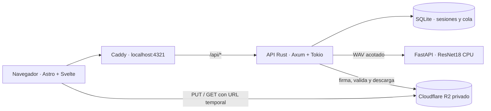

<p align="center">
  
</p>

<h1 align="center">Del ruido a la señal.</h1>

<p align="center">
  Un estudio web para explorar audio y detectar sirenas por ventanas temporales,
  con inferencia reproducible en CPU y almacenamiento privado.
</p>

<p align="center">
  <a href="#puesta-en-marcha">Puesta en marcha</a> ·
  <a href="#cómo-interpretar-los-resultados">Resultados</a> ·
  <a href="#arquitectura">Arquitectura</a> ·
  <a href="#documentación">Documentación</a>
</p>

---

## Qué es Doppler

Doppler convierte un archivo WAV en un análisis temporal que puedes escuchar,
inspeccionar y exportar. Su estudio interactivo reúne la forma de onda, una
visualización espectral, el progreso del procesamiento y los scores de un modelo
ResNet18 entrenado para distinguir las clases `EMERGENCY` y `NON_EMERGENCY`.

Este repositorio implementa la aplicación que sirve ese modelo: interfaz,
almacenamiento, sesiones, cola de trabajos e inferencia. El experimento de
aprendizaje automático que la sustenta está descrito en el
[contrato del modelo](docs/model-contract.md).

**El alcance es la ejecución y validación local en Linux mediante Docker Compose,
con Cloudflare R2 real.** Los resultados de rendimiento deben medirse en el equipo
donde se ejecuta; las pruebas técnicas con audio sintético no equivalen a una
evaluación de precisión sobre grabaciones reales.

## Qué puedes hacer

- **Analizar un WAV:** validación previa en el navegador, subida directa a R2 y
  procesamiento mediante una cola persistente en SQLite.
- **Explorar el audio:** reproducción, forma de onda, espectrograma y navegación
  por ventanas de análisis.
- **Examinar cada predicción:** score, clase y límites temporales, junto con el
  umbral utilizado y los tiempos de las etapas del pipeline.
- **Conservar resultados verificables:** exportaciones JSON y CSV; hashes del
  audio, del modelo y del contrato para identificar la ejecución.
- **Gestionar los trabajos de tu sesión:** historial, reproducción mediante URLs
  temporales y eliminación; retención automática configurable.
- **Reportar discrepancias y operar el mantenimiento:** formulario integrado de
  retroalimentación por ventana en el Estudio y consola administrativa
  `/mantenimiento` protegida por `X-Admin-Token` para salud en vivo, incidentes,
  latencias desacopladas (30 días), drift entrada/salida y auditoría de modelo.

## Cómo interpretar los resultados

El modelo evalúa **ventanas completas de 3 segundos con un salto de 1,5 segundos**.
Las ventanas consecutivas se solapan: contar ventanas positivas no equivale a
sumar segundos de sirena.

| Concepto | Significado |
| --- | --- |
| Score | Salida sigmoide entre 0 y 1, **sin calibración probabilística**. No es un porcentaje de confianza. |
| `EMERGENCY` | Score mayor o igual al umbral congelado `0.6547843813896179`. |
| `NON_EMERGENCY` | Score inferior al umbral. |
| Intervalos unidos | Unión de ventanas positivas solapadas; no delimita el inicio y fin exactos de una sirena. |
| Resultado del archivo | Resumen de predicciones por ventana; no existe una clasificación global validada del archivo. |

Con los valores predeterminados se admiten archivos **WAV de hasta 25 MiB y
120 segundos**. Un clip menor de 3 segundos no produce ventanas completas. La cola
final que no completa otra ventana se descarta y se informa; no se rellena audio
silenciosamente.

El pipeline transforma el audio a mono y 16 kHz, normaliza su pico a 0,99 y genera
matrices Log-Mel de `64 × 94`. Utiliza las estadísticas congeladas del entrenamiento
y carga el checkpoint estrictamente en CPU, sin descargar pesos ImageNet al
arrancar. La especificación completa vive en
[docs/model-contract.md](docs/model-contract.md).

## Puesta en marcha

Ejecuta los comandos desde la raíz del repositorio.

### 1. Preparar los requisitos

Para levantar la aplicación necesitas:

- Docker Engine y Docker Compose v2.
- Python 3 para verificar R2 y generar el secreto de sesión.
- Un bucket **privado** de Cloudflare R2 y credenciales S3 API con permisos de
  lectura y escritura de objetos sobre ese bucket.
- Los artefactos originales `model.pt` e `inference.json`.

**El checkpoint y la configuración del modelo no se incluyen en Git.** Coloca los
artefactos entregados en esta estructura antes de construir los servicios:

```text
Doppler_Espectro_Brand_Kit/
└── model/
    ├── model.pt
    └── inference.json
```

Compose monta ese directorio en `/models` en modo de solo lectura. Conserva los
originales sin modificarlos. Si necesitas otra ubicación, adapta el montaje en
[docker-compose.yml](docker-compose.yml); cambiar únicamente `MODEL_PATH` en `.env`
no cambia el directorio montado por la configuración actual.

Para desarrollo frontend y pruebas de navegador necesitas además **Node.js
compatible con las dependencias del workspace y pnpm 10.0.0**. La imagen web fija
Node.js `24.11.0`. El servicio de inferencia utiliza Python `3.12.9` dentro de su
contenedor; no necesitas instalar PyTorch en el host para el arranque con Compose.

### 2. Configurar el entorno

```bash
cp .env.example .env
```

Completa al menos estas variables en `.env`:

| Variable | Contenido |
| --- | --- |
| `R2_ACCOUNT_ID` | Identificador de tu cuenta Cloudflare. |
| `R2_ACCESS_KEY_ID` | Identificador de la credencial S3 API. |
| `R2_SECRET_ACCESS_KEY` | Secreto de la credencial S3 API. |
| `R2_BUCKET` | Nombre del bucket privado. |
| `SESSION_HMAC_SECRET` | Secreto aleatorio para firmar las sesiones anónimas. |
| `ADMIN_API_TOKEN` | Token administrativo local para `/api/admin/*` y `/mantenimiento`. |

Genera el secreto y copia el valor en `SESSION_HMAC_SECRET`:

```bash
python3 -c "import secrets; print(secrets.token_hex(32))"
```

La plantilla documenta también límites, prefijos de almacenamiento, vencimientos y
recursos CPU. `.env` queda excluido de Git y del contexto de construcción Docker.

### 3. Configurar y verificar R2

Aplica la política de [config/r2-cors.json](config/r2-cors.json) desde la configuración
CORS del bucket, conservando las reglas ajenas al proyecto. El origen
predeterminado es `http://localhost:4321`; debe coincidir con el que utilices en el
navegador y con `APP_ORIGIN`.

Comprueba después el acceso y el ciclo de subida y descarga:

```bash
python3 scripts/r2_check.py
```

El comprobador crea y elimina objetos de prueba bajo `R2_TEST_PREFIX`. Para intentar
configurar CORS por API puedes usar `--ensure-cors`; esa operación requiere
permisos adicionales de administración del bucket. Con credenciales limitadas a
objetos, configura CORS desde el panel. Consulta la
[guía de R2](docs/r2-setup.md) para los detalles.

### 4. Construir y arrancar

```bash
docker compose up -d --build
```

La primera construcción instala dependencias y compila los servicios. Compose
espera a que inferencia esté disponible antes de iniciar la API, y a que la API
esté saludable antes de iniciar la web.

```bash
docker compose ps
curl -fsS http://localhost:4321/api/health | python3 -m json.tool
```

Abre **[http://localhost:4321](http://localhost:4321)**. Revisa en la respuesta de
salud el acceso a R2 y la disponibilidad de inferencia antes de analizar audio.

### 5. Realizar el primer análisis

1. Selecciona o arrastra un WAV de al menos 3 segundos dentro de los límites.
2. Inicia el análisis y sigue el progreso de subida y procesamiento.
3. Revisa las ventanas, escucha los intervalos y compara sus scores con el umbral.
4. Exporta los resultados en JSON o CSV si necesitas conservarlos.

Para detener los servicios:

```bash
docker compose down
```

El volumen de SQLite se conserva entre arranques. La opción `down -v` elimina ese
volumen local y sus registros; no sustituye la eliminación de objetos en R2.

## Arquitectura



La API autoriza la subida mediante una URL firmada; el navegador envía el WAV
directamente a R2. Al confirmar la subida, Rust verifica el tamaño real del objeto
antes de encolar el trabajo. El worker descarga el audio con un límite de tamaño,
lo envía al servicio de inferencia y persiste el resultado en SQLite.

| Servicio | Responsabilidad | Acceso predeterminado |
| --- | --- | --- |
| `web` | Frontend estático Astro 5, isla Svelte 5, Tailwind CSS v4 y proxy Caddy. | `http://localhost:4321` |
| `api` | Sesiones HMAC, URLs firmadas, validación, cola, exportaciones y retención. | `127.0.0.1:18080` para depuración |
| `inference` | Preparación acústica y ResNet18 con PyTorch CPU, en un proceso. | `127.0.0.1:18090` para depuración |
| R2 | Almacenamiento remoto de los WAV originales. | HTTPS mediante API S3 |

La cola procesa un trabajo de inferencia a la vez por defecto y recupera su estado
tras reiniciar la API. Las credenciales R2 se entregan exclusivamente al servicio
Rust. Los puertos publicados se vinculan a loopback para la ejecución local.

## Privacidad y ciclo de vida de los datos

- El audio original se almacena en **R2 remoto**; la inferencia se ejecuta en tu
  entorno local.
- Una cookie de sesión anónima firmada identifica los trabajos accesibles desde
  ese navegador.
- El bucket permanece privado. La reproducción utiliza URLs GET con vencimiento;
  sus valores predeterminados son 180 segundos para GET y 300 para PUT.
- La retención predeterminada es de **24 horas**, con limpieza periódica cada
  300 segundos. No implica eliminación instantánea al cumplirse el plazo.
- Las operaciones de la aplicación se limitan a `R2_PREFIX`; las pruebas utilizan
  `R2_TEST_PREFIX`. Mantén ambos prefijos separados.
- Las evidencias deben excluir credenciales, cookies, URLs firmadas y checkpoints.

## Desarrollo y calidad

Instala las dependencias del workspace con su lockfile:

```bash
pnpm install --frozen-lockfile
```

| Comando | Propósito |
| --- | --- |
| `pnpm run dev:web` | Iniciar Astro en desarrollo; requiere una API disponible en `127.0.0.1:18080`. |
| `pnpm run build:web` | Generar el frontend estático. |
| `pnpm run check:web` | Comprobar tipos y componentes Astro/Svelte. |
| `pnpm run lint` | Ejecutar oxlint. |
| `pnpm run format:check` | Verificar los archivos incluidos en la configuración de oxfmt. |
| `docker compose logs -f` | Consultar los logs de los servicios locales. |

El servidor de desarrollo y Caddy utilizan el puerto 4321 por defecto: libera ese
puerto antes de iniciar Astro. Para mantener la reproducibilidad, usa pnpm y
versiones exactas; conserva los lockfiles.

Husky ejecuta `lint-staged` en `pre-commit` y commitlint en `commit-msg`. Los commits
siguen Conventional Commits, por ejemplo `feat(web): add window score chart` o
`docs: clarify local setup`. Las convenciones completas están en
[AGENTS.md](AGENTS.md) y el sistema visual en [DESIGN.md](DESIGN.md).

## Pruebas y evidencias

Cada nivel responde a una pregunta distinta. Las fixtures sintéticas verifican el
comportamiento del sistema; no permiten deducir su precisión predictiva en campo.

| Nivel | Qué verifica | Requisitos |
| --- | --- | --- |
| Unitarias Rust | Firma de sesiones, nombres de archivo e intervalos solapados. | Toolchain Rust o construcción de la imagen API. |
| Paridad y WAV | Coincidencia con una referencia independiente de los notebooks y casos límite de audio. | Imagen de inferencia y artefactos del modelo. |
| Integración | Ciclo real API–R2–inferencia, aislamiento de sesiones y persistencia. | Stack activo y bucket configurado. |
| Navegador | Flujos del estudio, teclado, móvil, temas y movimiento reducido. | Stack activo, dependencias JS y navegador Playwright. |

Prueba de paridad sin acceso a red, después de construir la imagen:

```bash
docker run --rm --network none \
  -v "$(pwd)/Doppler_Espectro_Brand_Kit/model:/models:ro" \
  doppler-inference:1.0.0 \
  sh -c "ruff check --no-cache src tests && pytest -v -o cache_dir=/tmp/pytest_cache tests/test_parity_and_files.py"
```

Integración y navegador con la aplicación en ejecución:

```bash
python3 tests/integration/test_api_and_r2.py
pnpm exec playwright install chromium
pnpm run test:e2e
```

La suite de integración realiza operaciones reales sobre R2 y reinicia la API como
parte de la comprobación de persistencia. Ejecútala en el entorno de desarrollo.

Para generar informes, benchmarks, diagramas y capturas, y empaquetar la última
ejecución con manifiesto SHA-256:

```bash
pnpm run evidence:generate
pnpm run evidence:pack
```

Las salidas se guardan en `evidence/`, excluido de Git. Consulta las guías de
[pruebas](docs/testing.md) y [evidencias](docs/evidence.md) para el protocolo y sus
dependencias.

## Mapa del repositorio

```text
doppler-deploy/
├── apps/web/             Interfaz Astro + Svelte y recursos de marca
├── services/api/         API Rust, migraciones SQLite y worker
├── services/inference/   Pipeline acústico, modelo y pruebas de paridad
├── config/               Proxy Caddy y política CORS de R2
├── scripts/              Verificación R2, benchmarks y evidencias
├── tests/                Integración real y pruebas Playwright
├── docs/                 Contratos, arquitectura y guías operativas
└── docker-compose.yml    Orquestación del entorno local
```

Los artefactos originales en `Doppler_Espectro_Brand_Kit/`, las credenciales en
`.env` y los informes en `evidence/` se mantienen fuera del historial de Git.

## Documentación

| Si necesitas… | Consulta |
| --- | --- |
| Entender el modelo, su procedencia y sus invariantes | [Contrato del modelo](docs/model-contract.md) |
| Revisar componentes, flujo de datos o reemplazo de checkpoints | [Arquitectura](docs/architecture.md) |
| Consumir los endpoints HTTP | [OpenAPI 3.1](docs/openapi.yaml) |
| Configurar bucket, permisos, CORS y prefijos | [Configuración de R2](docs/r2-setup.md) |
| Ejecutar la validación técnica | [Guía de pruebas](docs/testing.md) |
| Generar y auditar informes reproducibles | [Guía de evidencias](docs/evidence.md) |
| Operar monitoreo, drift, retroalimentación y actualizaciones del modelo | [Monitoreo y Mantenimiento](docs/maintenance-operations.md) |
| Resolver fallos de arranque, subida o inferencia | [Solución de problemas](docs/troubleshooting.md) |
| Contribuir siguiendo las convenciones del proyecto | [Guía de ingeniería](AGENTS.md) · [Sistema de diseño](DESIGN.md) |
